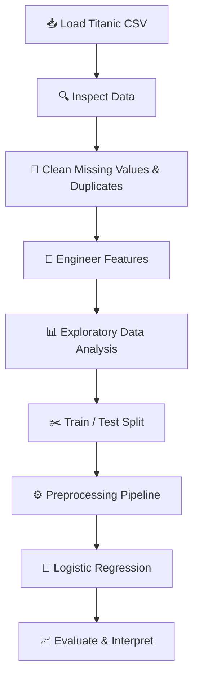
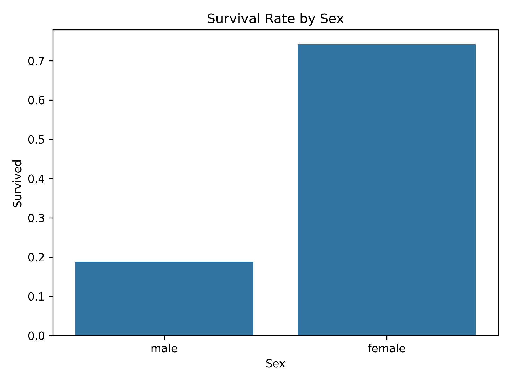
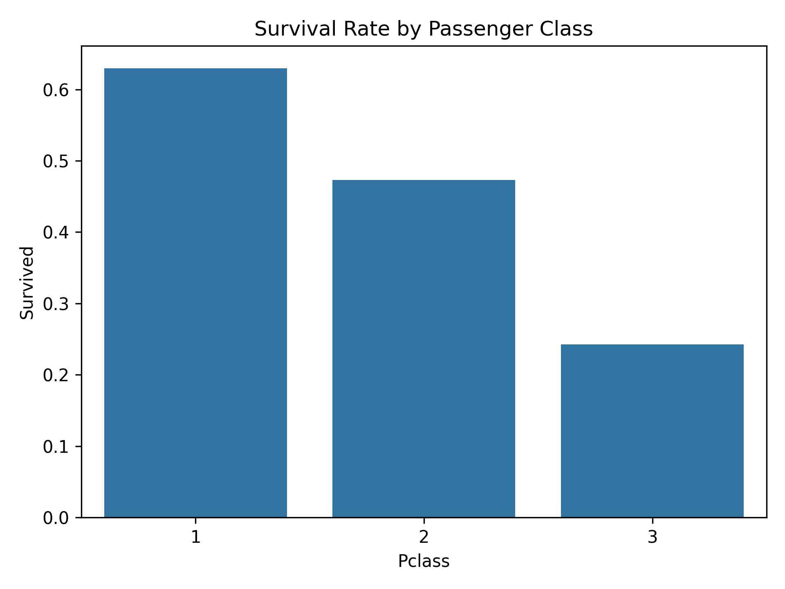

<div align="center">

# 🚢 Titanic Survival Analysis
### From Raw Passenger Data to Survival Prediction

**An end-to-end Python project exploring the patterns behind Titanic passenger survival.**


**Data Cleaning** · **EDA** · **Feature Engineering** · **Machine Learning**

</div>

---

## 📌 At a Glance

> **Goal:** Understand which passenger characteristics were associated with survival and build a baseline model to predict the `Survived` outcome.

| 🎯 Area | 🔎 What this project covers |
|:--|:--|
| **Dataset** | Titanic passenger records (`titanic.csv`) |
| **Analysis** | Sex, age, ticket class, fare, family size, embarkation |
| **Data preparation** | Missing values, duplicates, feature engineering |
| **Visualizations** | Count plots, bar charts, histograms, box plots, heatmaps |
| **Prediction** | Logistic Regression with scikit-learn pipelines |
| **Evaluation** | Accuracy, precision, recall, F1-score, confusion matrix |

## 🧭 Contents

- [Project Questions](#-project-questions)
- [Technology Stack](#-technology-stack)
- [Dataset Overview](#-dataset-overview)
- [Analysis Workflow](#-analysis-workflow)
- [Visualizations](#-visualizations)
- [Modeling Approach](#-modeling-approach)
- [Results & Insights](#-results--insights)
- [Project Structure](#-project-structure)
- [Getting Started](#-getting-started)
- [Future Improvements](#-future-improvements)

## ❓ Project Questions

1. **Survival:** What percentage of passengers survived?
2. **Sex:** How did survival rates differ by sex?
3. **Class:** Were survival rates different across passenger classes?
4. **Age:** How did age groups compare?
5. **Fare:** Was ticket fare associated with survival?
6. **Family:** Did traveling alone or with family relate to survival?
7. **Embarkation & cabin:** Did boarding port or recorded cabin information show meaningful patterns?

> 💡 **Analytical principle:** Compare *survival rates*, not just survivor counts. Association does not establish causation.

## 🛠️ Technology Stack

| Category | Tools |
|:--|:--|
| Programming | Python |
| Data manipulation | Pandas, NumPy |
| Visualization | Matplotlib, Seaborn |
| Machine learning | scikit-learn |
| Development | Jupyter Notebook, Anaconda / VS Code |
| Data files | CSV; optional Excel export with openpyxl |

## 📂 Dataset Overview

The commonly used Titanic training dataset contains the following columns:

| Feature | Description |
|:--|:--|
| `PassengerId` | Unique passenger identifier |
| `Survived` | Target: `0` = No, `1` = Yes |
| `Pclass` | Passenger class (1st, 2nd, 3rd) |
| `Name` | Passenger name |
| `Sex` | Passenger sex |
| `Age` | Age in years |
| `SibSp` | Siblings/spouses aboard |
| `Parch` | Parents/children aboard |
| `Ticket` | Ticket identifier |
| `Fare` | Ticket fare |
| `Cabin` | Recorded cabin identifier |
| `Embarked` | Embarkation port (`C`, `Q`, `S` in the standard dataset) |

**Missing-data decision:** The `Cabin` column is **retained** rather than dropped. For analysis, unknown cabins can be labeled `"Unknown"`; a separate `CabinKnown` flag can preserve the distinction between recorded and missing information. This keeps passenger rows available for analysis.

> Actual column names, row counts, and missing-value counts depend on the dataset version.

## 🔄 Analysis Workflow



<details>
<summary><b>1. Data inspection & cleaning</b></summary>

- Inspect `head()`, `info()`, `describe()` and `dtypes`.
- Count missing values and duplicates.
- Handle missing `Age` and `Embarked` values appropriately.
- Preserve `Cabin` and passenger records.
- Save the cleaned dataset as `csv/titanic_updated.csv` when needed.

</details>

<details>
<summary><b>2. Feature engineering</b></summary>

| New feature | Logic |
|:--|:--|
| `FamilySize` | `SibSp + Parch + 1` |
| `IsAlone` | `1` if `FamilySize == 1`, else `0` |
| `CabinKnown` | `1` if cabin is recorded, else `0` |
| `AgeGroup` | Age ranges for comparison and visualization |

</details>

<details>
<summary><b>3. Exploratory data analysis</b></summary>

- Survival distribution and overall survival rate
- Survival rates by sex and class
- Age distribution and age-group survival
- Fare differences between survival groups
- Family size and embarkation comparisons
- Correlation analysis of numerical features

</details>

## 📊 Visualizations

Suggested charts to include in the notebook or `visualizations/` folder:

| Chart | Purpose |
|:--|:--|
| **Survival Count Plot** | Compare survived vs. not survived |
| **Survival by Sex** | Compare group-level survival rates |
| **Survival by Class** | Explore passenger-class differences |
| **Age Distribution** | Understand the age profile of passengers |
| **Fare Box Plot** | Examine spread and outliers |
| **Family Size Bar Chart** | Compare survival rates by family size |
| **Correlation Heatmap** | Explore numerical relationships |

<!-- Add real chart screenshots here once exported:


-->

## 🤖 Modeling Approach

**Baseline algorithm:** Logistic Regression for binary classification.

The model uses available passenger features such as `Pclass`, `Sex`, `Age`, `Fare`, `Embarked`, `SibSp`, `Parch`, and engineered family features.

**Preprocessing:**
- Split the labeled data into training and testing sets.
- Impute numeric values using the training-set median.
- Impute categorical values using the training-set mode.
- Scale numeric variables and one-hot encode categorical variables.
- Use `ColumnTransformer` and `Pipeline` to prevent preprocessing leakage.

```python
from sklearn.compose import ColumnTransformer
from sklearn.pipeline import Pipeline
from sklearn.impute import SimpleImputer
from sklearn.preprocessing import OneHotEncoder, StandardScaler
from sklearn.linear_model import LogisticRegression

numeric_features = X_train.select_dtypes(include="number").columns.tolist()
categorical_features = X_train.select_dtypes(exclude="number").columns.tolist()
```

**Evaluation metrics:** Accuracy · Precision · Recall · F1-score · Confusion Matrix

> ⚠️ For model training, start with the original data and fit imputation **inside the training pipeline**. Avoid calculating missing-value replacements on the full dataset before the split.

## 📈 Results & Insights

*Fill in the values below after running the analysis and evaluating your model.*

| Metric | Your result |
|:--|--:|
| Total passengers analyzed | _Pending_ |
| Overall survival rate | _Pending_ |
| Highest observed survival-rate group | _Pending_ |
| Logistic Regression test accuracy | _Pending_ |
| Test F1-score | _Pending_ |

### Key Findings

> 📝 **To be completed from actual analysis results.** Summarize the strongest patterns you observed, include relevant percentages, and mention limitations such as missing cabin data or small subgroup sizes.

No accuracy scores or survival statistics have been fabricated in this README.

## 🗂️ Project Structure

```text
Titanic-Survival-Analysis/
│
├── csv/
│   ├── titanic.csv
│   └── titanic_updated.csv
│
├── visualizations/             # Optional exported charts
├── titanic_analysis.ipynb      # Main notebook
├── requirements.txt            # Optional dependency list
└── README.md
```

*Rename or remove entries to match the files actually in your repository.*

## 🚀 Getting Started

**1. Clone the repository**

```bash
git clone <YOUR-REPOSITORY-URL>
cd Titanic-Survival-Analysis
```

Replace `<YOUR-REPOSITORY-URL>` with your actual GitHub repository URL.

**2. Install dependencies**

```bash
pip install pandas numpy matplotlib seaborn scipy scikit-learn openpyxl jupyter
```

**3. Load the dataset**

```python
import pandas as pd

df = pd.read_csv("csv/titanic.csv")
print(df.shape)
df.head()
```

**4. Run the notebook**

```bash
jupyter notebook
```

Open `titanic_analysis.ipynb` and run the cells in order. Adjust file paths to match your folders.

## 🌱 Future Improvements

- [ ] Compare Logistic Regression with Decision Tree and Random Forest.
- [ ] Apply cross-validation and hyperparameter tuning.
- [ ] Study known cabin decks and missingness patterns.
- [ ] Create an interactive Power BI dashboard.
- [ ] Add model explainability and error analysis.
- [ ] Include exported charts and verified results in this README.

## 📚 Dataset Source & Usage

Add a link to the **exact dataset source** used in this project and verify its license or reuse terms before publishing the CSV.

---

<div align="center">

### ⭐ Titanic Survival Analysis

**Python • Data Analytics • EDA • Machine Learning**

*Built as a hands-on data science portfolio project.*

</div>
